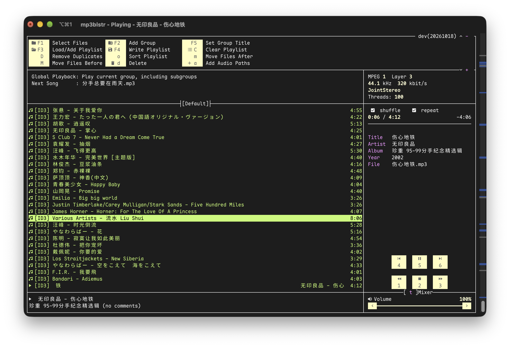

# mp3blstr

mp3blstr is a modern reimplementation of the classic **[mp3blaster](https://github.com/stragulus/mp3blaster)** which was originally created by Bram Avontuur. It keeps the screen layout, keyboard shortcuts,
playback logic and playlist files you already know, rebuilt from scratch in pure Go for macOS, Linux, Windows and FreeBSD, and adds what a desktop player needs today: true colour themes, mouse support, system media controls and album art.



## Why mp3blstr

More than two decades ago, a single terminal window was the whole workbench: a long playlist on the
left, a row of CD-player buttons on the right, and the keys `1` to `6` for rewind, stop, forward,
previous, play and next, without your hands ever leaving the keyboard. mp3blaster has not been
maintained since 2017, and its aging audio interfaces no longer build on modern systems.

mp3blstr has a simple goal: make that muscle memory useful again, and keep it running for the next twenty years.

## Product highlights

### 🎛️ Faithful to the original

- The same screen layout, default keys and playback logic. Longtime users feel at home instantly.
- Opens original `.lst` playlists and `.m3u` files as they are.
- Playlist groups nest without limit. Organize by album, mood or decade, then play one group, a
  group with its subgroups, or everything at random.

### ✨ A fresh coat of paint

- **Two themes**: the classic colour scheme or a modern true colour look with rounded borders,
  switchable at runtime.
- **Nerd Font icons** for buttons, list entries and status, with the playing song's name scrolling.
- **Full mouse support**: click CD buttons, jump through the progress bar, set the volume, double
  click to play. Works just as well for keyboard purists.
- **Transparent background** that follows your terminal, so translucent terminals still show the
  wallpaper.
- **Adaptive layout**: on wide terminals the information panel expands with bitrate, sample rate,
  full tags and a clickable progress bar.

### 🖥️ At home on your desktop

- **System media controls**: macOS Now Playing in Control Center and KDE/GNOME controls via MPRIS
  on Linux, both with track information, playback position, seeking and embedded cover art.
  Windows gets global media hotkeys.
- **Linux desktop integration**: repeat and shuffle stay in sync with the desktop controls, the
  desktop can adjust volume and open files, and `--reuse-instance --enqueue` sends songs to a
  running player without interrupting playback.
- **Pauses when it should**: playback pauses when your machine goes to sleep (Linux and macOS) or
  when the audio output changes (macOS). It never blasts through the wrong speakers.
- **Drag, drop and paste**: drop files into the terminal or paste a batch of paths and HTTP(S)
  streams. Bracketed paste keeps pasted text from triggering commands.

### 🧠 Remembers where you left off

- **Session resume**: your playlist, last song and playback position are waiting on the next launch.
- **Settings that stick**: themes, volume, play mode and other settings you change while listening
  are written back to the configuration file, keeping your comments and layout.
- **Metadata cache**: tags and durations are read once and cached, so large libraries browse and
  sort faster.

### 🎧 Sounds good, works well

- MP3, FLAC, Ogg Vorbis, WAV and Shoutcast/Icecast internet radio.
- Fade out at the end of a song and fade in the next one for smooth transitions.
- Sort by name, artist, title, duration or size, or shuffle. Numbers sort naturally (`2` before
  `10`). Duplicates are removed in one keystroke.
- Recovers mislabeled UTF-8/GBK/GB18030 ID3 tags, so song names from old MP3s display correctly.
- Recursive scans and "directories as groups" run in the background with a progress dialog. You can
  cancel at any time, and the music keeps playing.

## Technical highlights

- **Pure Go, no cgo**: no C headers or toolchain required. One command cross-compiles to seven
  platform/architecture targets.
- **Native audio output** through [oto](https://github.com/ebitengine/oto): CoreAudio, WASAPI, and
  PulseAudio or ALSA.
- **A single binary**: download and run, with no runtime to install and no `.app` wrapper needed.
- **A clean, layered architecture**: UI, application logic, playback control and audio decoding are
  decoupled, so the core logic is tested without a terminal or sound card.
- **Lock-free event model**: playback control runs only on the UI event loop, and background work
  reports back through messages. The original's tangle of threads and mutexes is gone.
- **Safe persistence**: configuration and playlists are written atomically and stay intact even if
  the program is interrupted.
- **Low idle overhead**: when paused or idle, periodic redraws stop and audio output is suspended.
- **Continuous integration** on Linux, macOS and Windows, with automatic releases from version tags.

## Quick start

Download the archive for your platform from
[Releases](https://github.com/mingcheng/mp3blstr/releases), or build from source with Go 1.27+:

```sh
git clone https://github.com/mingcheng/mp3blstr.git
cd mp3blstr
make build                       # produces bin/mp3blstr
make install PREFIX=$HOME/.local # optional on Linux: installs the binary and desktop launcher
```

> On Linux and BSD, audio output needs PulseAudio (or PipeWire's Pulse layer) or ALSA.

```sh
mp3blstr                            # start, restoring the last session
mp3blstr ~/Music/*.mp3              # play files
mp3blstr -l favorites.lst           # load a playlist
mp3blstr --theme modern --nerd-font # modern theme with icons
```

Inside the player, press `F1` to pick songs, `5` to play or pause, `?` for the full help screen and
`q` to quit.

## Configuration

Settings live in `~/.config/mp3blstr/config.yaml`, a readable YAML file covering themes, colours,
key bindings and playback behaviour. See [config.sample.yaml](config.sample.yaml) for every option
and its default, and [help.txt](internal/app/help.txt) for commands and key bindings.

```yaml
ui:
  theme: modern
  nerd_font: true
playback:
  fade_out: true
keys:
  play:
    next: n
```

## Acknowledgements

Many thanks to [Bram Avontuur](https://github.com/bramav) and everyone who contributed to mp3blaster.

## License and Contribution

This project is released under the MIT License, check the [LICENSE](LICENSE) file for details.

Contributions are welcome! Please fork the repository and submit pull requests for any improvements or bug fixes. For major changes, please open an issue first to discuss what you would like to change.   
